# Multimodal 3D Gaussian Splatting & Geometric Canopy LAI Estimation

[](https://www.python.org/downloads/)
[](https://pytorch.org/)
[](https://developer.nvidia.com/cuda-toolkit)
[](https://repo-sam.inria.fr/fungraph/3d-gaussian-splatting/)
[](LICENSE.md)

This repository contains the official implementation of **Multimodal (RGB + NIR) 3D Gaussian Splatting** alongside an **Automated Metric Scale Recovery & Point-Cloud Alignment Pipeline** for high-fidelity botanical canopy analysis and **Leaf Area Index (LAI)** estimation.

---

## 📌 Key Research Highlights

1. **Multimodal 3D Radiance Fields ($f_{\text{nir}}$ Feature Distillation):**
   * Extends explicit 3D Gaussian primitives with an optimizable 32-dimensional Near-Infrared ($f_{\text{nir}}$) feature embedding.
   * Eliminates error-prone 2D multimodal registration via unified 3D Structure-from-Motion (SfM) camera poses.
   * Utilizes a frozen spatial CNN encoder and **$\alpha$-masked Cosine Similarity Loss** to distill cross-spectral representations without representation collapse or sky-background artifacts.
   * Achieves **$L_1 = 0.0414$** on 4K RGB views while driving NIR Cosine loss down to **$0.0118$** across held-out angles.

2. **Automated 3DGS-to-TLS Metric Scale Regularization:**
   * Bridges the gap between arbitrary-scale RGB 3DGS reconstructions and metric Ground Truth from Terrestrial Laser Scanning (FARO TLS).
   * Fully automated alignment framework using **Statistical Outlier Removal (SOR)**, **DBSCAN clustering**, **PCA isotropic scaling**, and **Point-to-Plane Iterative Closest Point (ICP)**.
   * Recovers true metric scale with up to **$99.75\%$ geometric F-score**, reducing relative LAI error from $38.18\%$ down to **$5.33\%$**.

---

## 🖼️ Visual Results & Showcase

### 1. Multimodal RGB + NIR Feature Distillation
Comparison between the frozen NIR CNN feature targets and the 3DGS distilled $f_{\text{nir}}$ attributes rendered across novel test viewpoints:

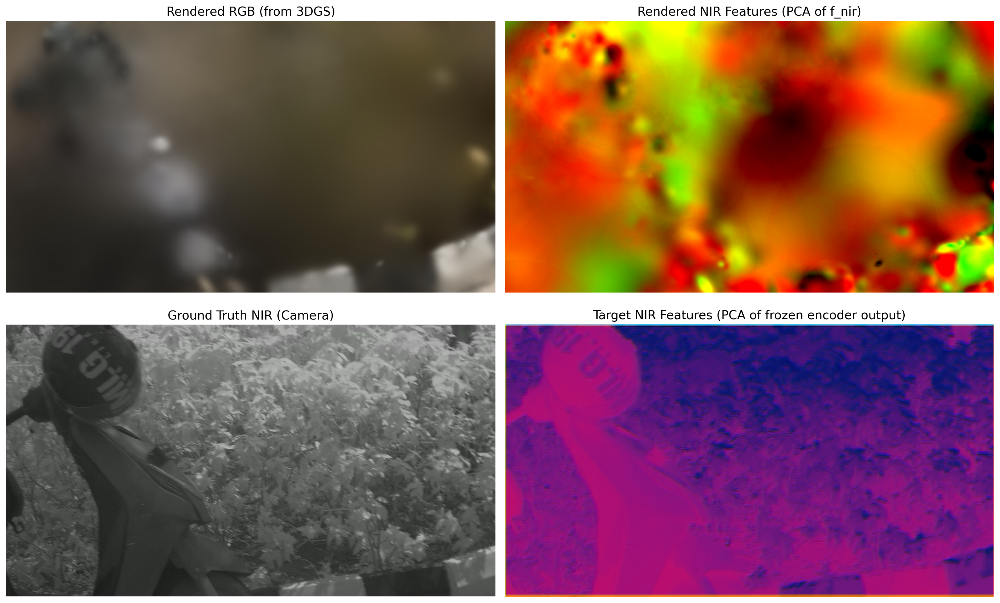

#### Held-Out Novel View Evaluation
| View 1 (nir_0029) | View 2 (nir_0040) | View 3 (nir_0050) |
| :---: | :---: | :---: |
| 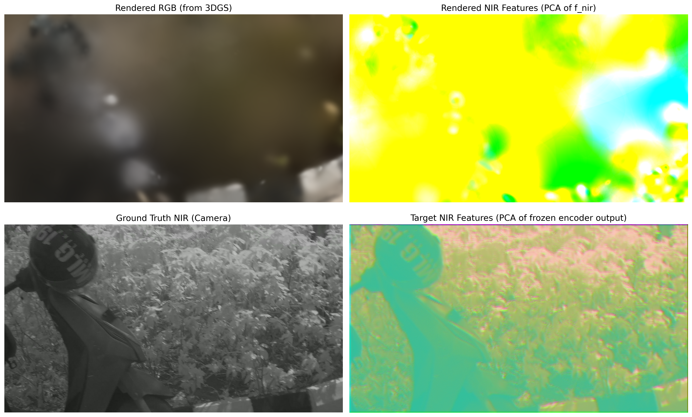 | 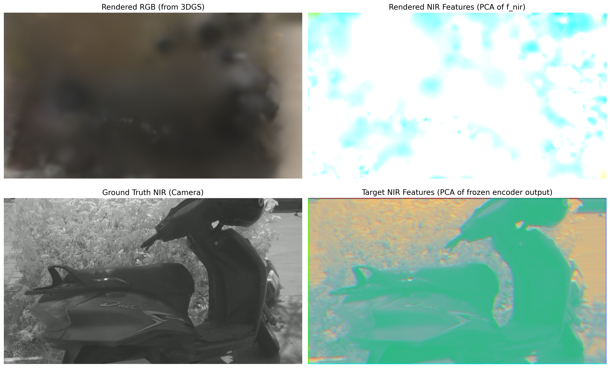 | 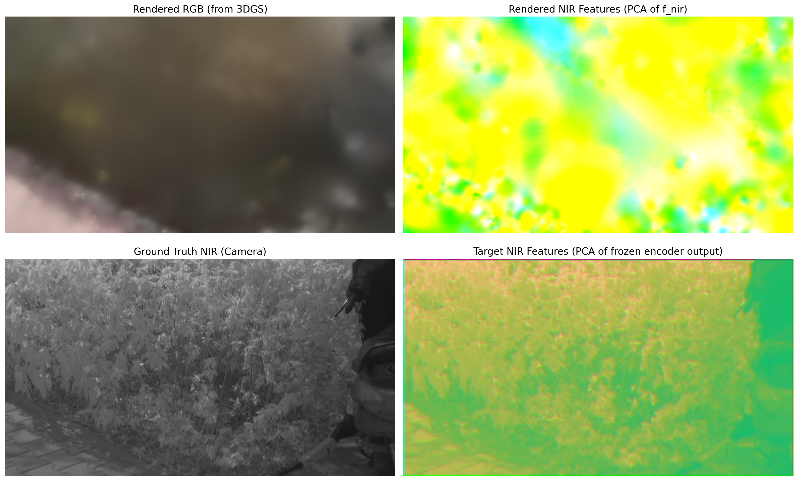 |

| View 4 (nir_0060) | View 5 (nir_0070) | Reconstructed Bush Canopy |
| :---: | :---: | :---: |
| 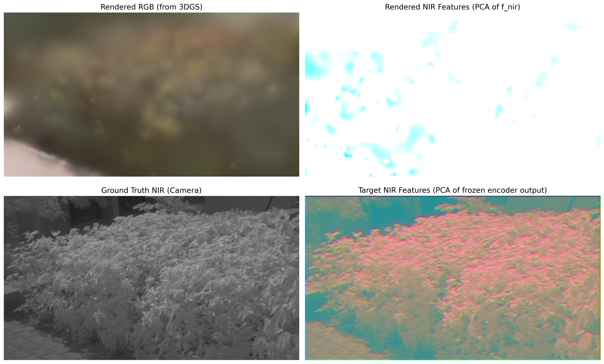 | 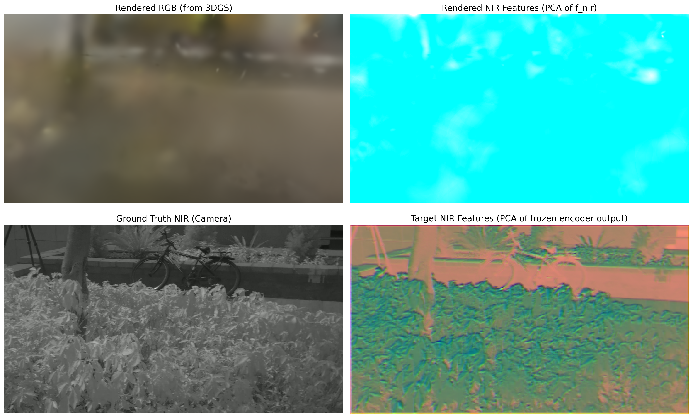 | 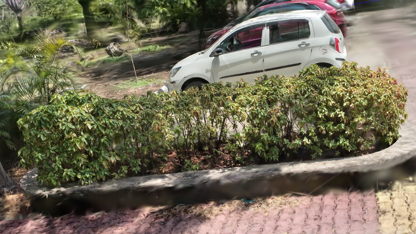 |

---

### 2. Automated Metric Scale Recovery & LAI Alignment Pipeline

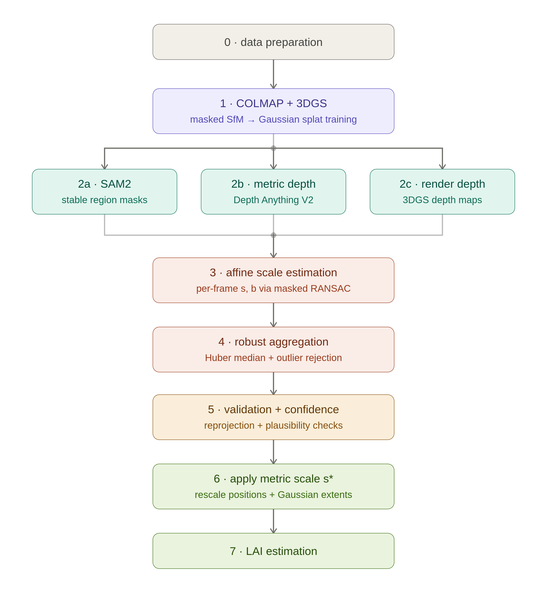

#### Point Cloud Alignment & Scale Mismatch Resolution
| Scale Mismatch Before vs After | Auto-Alignment Result |
| :---: | :---: |
| 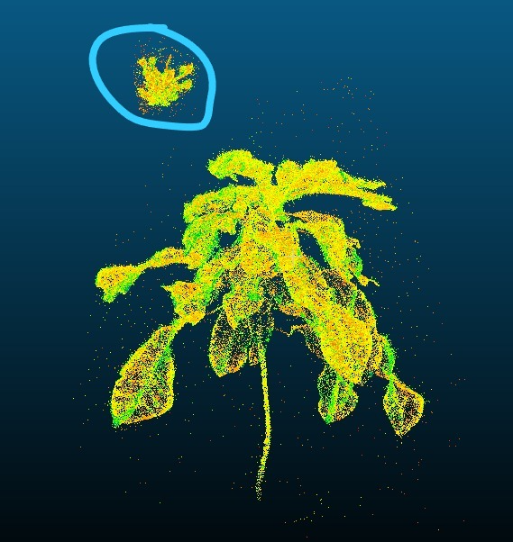 | 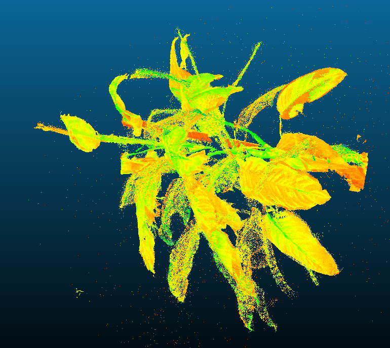 |

#### Empirical Evaluation & LAI Error Reduction
| Relative LAI Error Reduction Across Stages | Geometric Fidelity vs Ecological Accuracy |
| :---: | :---: |
| 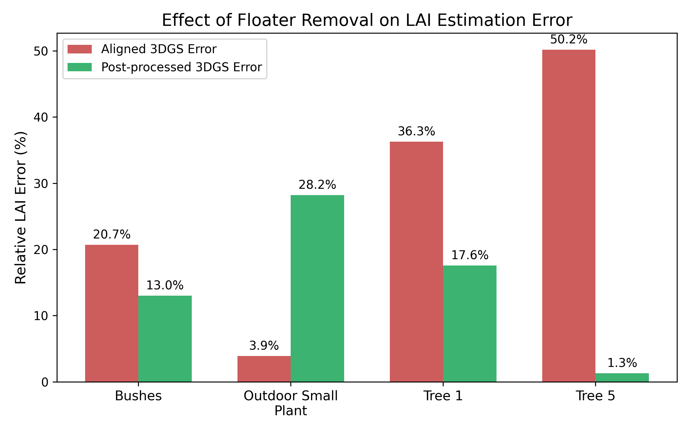 | 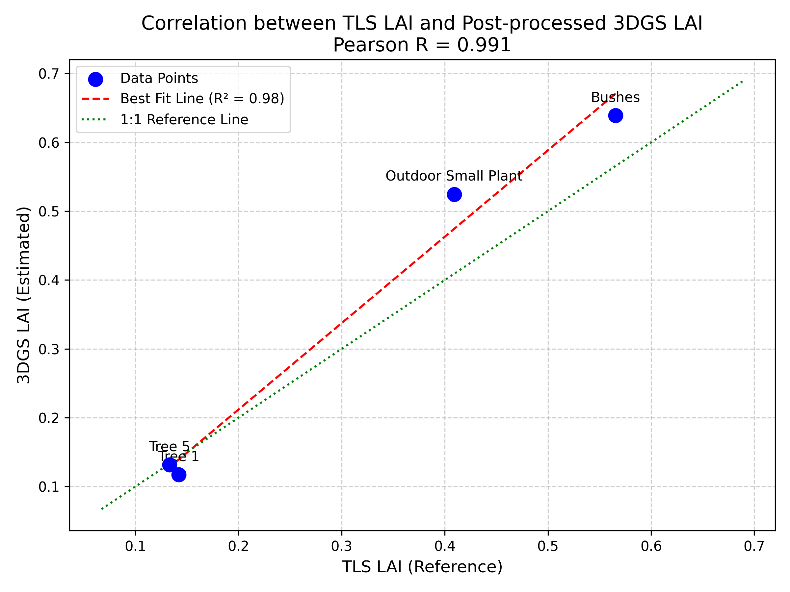 |

---

## 🏗️ System Architecture & Dataflow

```mermaid
graph TD
    %% Inputs
    subgraph Data_Inputs [Data Ingestion]
        RGB_Img["Raw RGB Video/Frames (4K)"]
        NIR_Img["Raw NIR Video/Frames (1080p)"]
        COLMAP["COLMAP Structure-from-Motion"]
    end

    RGB_Img --> COLMAP
    NIR_Img --> COLMAP
    COLMAP --> Poses["Unified Camera Poses (RGB + NIR)"]
    COLMAP --> Sparse["Sparse Point Cloud"]

    %% Initialization
    Sparse --> Init["Initialize 3D Gaussians"]
    Init --> Gaussians[("3D Gaussians: XYZ, RGB, Opacity, Scale, f_nir (32D)")]

    %% Forward Pass
    subgraph Forward_Pass [Differentiable Rasterizer (gsplat)]
        Gaussians --> Raster_RGB["Render RGB View (4K)"]
        Gaussians --> Raster_NIR["Render 32D f_nir Feature Map & Alpha Mask"]
    end

    Poses --> Raster_RGB
    Poses --> Raster_NIR

    %% Target Generation
    subgraph Target_Gen [Target Generation (Frozen)]
        NIR_Img --> CNN["Frozen Lightweight NIR CNN"]
        CNN --> Target_F["Target 32D Feature Map (H/4, W/4)"]
    end

    %% Loss Computation
    subgraph Loss_Comp [Loss Computation]
        Raster_RGB --> Loss_RGB["RGB Loss: L1 + SSIM"]
        RGB_Img --> Loss_RGB
        
        Raster_NIR --> Loss_NIR["NIR Loss: Alpha-Masked Cosine Similarity"]
        Target_F --> Loss_NIR
    end

    %% Backward Pass
    Loss_RGB --> Backprop["Backpropagation & Adam Optimizer"]
    Loss_NIR --> Backprop
    Backprop -.-> Gaussians
    Backprop -. absgrad .-> Densify["Adaptive Densification & Pruning"]
    Densify -. Grows .-> Gaussians
```

---

## 📊 Quantitative Benchmarks & Experimental Results

### 1. Leaf Area Index (FDTLS) Across Processing Stages
*Evaluated on isolated plant specimens against FARO TLS ground-truth reference scans:*

| Dataset | TLS Reference LAI | Unscaled 3DGS LAI | Scaled 3DGS LAI | Scaled + Floater Removed 3DGS |
| :--- | :---: | :---: | :---: | :---: |
| **Bushes** | 0.5656 | 1.1553 | 0.6455 | **0.6725** |
| **Outdoor Small Plant** | 0.4091 | 0.5055 | 0.5210 | **0.4660** |
| **Tree 1** | 0.1422 | 0.2708 | 0.2099 | **0.0683** |
| **Tree 5** | 0.1333 | 0.3120 | 0.0824 | **0.1262** |

### 2. Statistical Errors vs. TLS Reference
| Dataset | TLS LAI | Aligned Error (Abs \| Rel %) | Post-Processed Error (Abs \| Rel %) |
| :--- | :---: | :---: | :---: |
| **Bushes** | 0.5656 | 0.0799 \| 14.13% | 0.1069 \| 18.90% |
| **Outdoor Small Plant** | 0.4091 | 0.1119 \| 27.35% | **0.0569 \| 13.91%** |
| **Tree 1** | 0.1422 | 0.0677 \| 47.61% | 0.0739 \| 51.97% |
| **Tree 5** | 0.1333 | 0.0509 \| 38.18% | **0.0071 \| 5.33%** |
| **Overall Dataset MAE / Rel Error** | — | 0.0629 \| 27.77% | **0.0540 \| 15.03%** |

### 3. Geometric Convergence & Point-Cloud Distance Metrics
| Dataset | Scale Factor | ICP Fitness | ICP RMSE | Chamfer Distance | Cloud-to-Cloud RMSE | F-Score (@ 0.05m) |
| :--- | :---: | :---: | :---: | :---: | :---: | :---: |
| **Bushes** | 0.617 | 0.9958 | 0.0585 m | 0.0202 m | 0.0284 m | 94.37% |
| **Outdoor Small Plant** | 0.208 | 1.0000 | 0.0316 m | 0.0129 m | 0.0166 m | **99.08%** |
| **Tree 1** | 0.195 | 1.0000 | 0.0532 m | 0.0353 m | 0.0434 m | 78.49% |
| **Tree 5** | 0.169 | 0.9993 | 0.0270 m | 0.0059 m | 0.0094 m | **99.75%** |

---

## 📁 Repository Directory Structure

```text
├── assets/                                 # Showcase demonstration images and evaluation plots
│   ├── prompt5_multimodal_comparison.png  # Multimodal feature distillation held-out comparison
│   ├── heldout_view_1.png .. 5.png         # Individual test viewpoint comparisons
│   ├── metric_scale_recovery_pipeline.png # Automated PCA-ICP architecture diagram
│   └── ...                                 # Point-cloud alignment & LAI benchmark figures
├── gaussian-splatting/                     # Core Multimodal 3DGS codebase
│   ├── arguments/                          # Hyperparameters & model configurations
│   ├── gaussian_renderer/                  # Modified renderer with f_nir splatting support
│   ├── models/                             # Frozen lightweight NIR CNN encoder
│   ├── scene/                              # Dataset readers (RGB + NIR unified loader) & GaussianModel
│   ├── submodules/                         # diff-gaussian-rasterization & simple-knn CUDA extensions
│   ├── train.py                            # Multimodal training loop with masked cosine loss
│   ├── render_comparison.py                # Visual comparison generation script
│   ├── precompute_vit.py                   # Precomputation utilities for feature targets
│   └── vit_implementation_plan.md          # Technical notes & ViT distillation strategy
├── LAI/                                    # Leaf Area Index & Metric Alignment Research
│   ├── LAI_Optimization/
│   │   └── Scale_Regularisation/           # Automated PCA-ICP alignment scripts (auto_align.py)
│   ├── Report/                             # WACV LaTeX source (updated_paper.tex), metrics scripts
│   ├── report.md                           # Research experiment log & progression
│   └── report_summary.md                   # Summary of LAI estimation findings
├── smoke_test/                             # Mathematical & integration unit tests
│   ├── test_cross_modal_fusion.py          # Spatial cross-correlation & parallax gradient tests
│   └── test_nir_preprocessing.py           # 14-bit RAW bilateral filtering & noise boost tests
├── test/                                   # Sanity checks and sensor zoom scripts (zoom_test.py)
├── dinov2/                                 # Vision Transformer feature backbone utilities
├── pipeline_overview.md                    # Architectural overview & dataflow specifications
├── .gitignore                              # Comprehensive ignore rules (excluding 130GB+ datasets)
└── README.md                               # Project documentation (this file)
```

---

## ⚙️ Installation & Setup Guide

### 1. Clone the Repository
```bash
git clone https://github.com/Prowler0204/nir_feature-to-3dgs.git
cd nir_feature-to-3dgs
```

### 2. Environment Setup (Conda)
Ensure you have **Python 3.9+** and a CUDA-enabled PyTorch environment installed (CUDA 11.8 or CUDA 12.1 recommended):

```bash
# Create and activate conda environment
conda create -n multimodal-3dgs python=3.9 -y
conda activate multimodal-3dgs

# Install PyTorch with CUDA support (adjust cuda version to match your system)
pip install torch torchvision --index-url https://download.pytorch.org/whl/cu118
```

### 3. Install Submodules & Dependencies
Build the C++/CUDA rasterization extensions:

```bash
# Install core requirements
pip install -r gaussian-splatting/requirements.txt
pip install open3d opencv-python matplotlib scipy

# Build diff-gaussian-rasterization and simple-knn
pip install gaussian-splatting/submodules/diff-gaussian-rasterization
pip install gaussian-splatting/submodules/simple-knn
```

---

## 🚀 Quickstart & Usage

### 1. Run Mathematical Smoke Tests
Validate cross-modal fusion mechanics, bilateral filtering, and gradient preservation:

```bash
python smoke_test/test_cross_modal_fusion.py
python smoke_test/test_nir_preprocessing.py
```

### 2. Train the Multimodal (RGB + NIR) 3DGS Model
Run training on a preprocessed COLMAP scene containing both RGB and NIR camera registrations:

```bash
python gaussian-splatting/train.py -s <path_to_colmap_scene> --model_path output/multimodal_experiment
```

Key training parameters:
* `--model_path`: Output directory for checkpoints and rendered point clouds.
* `--iterations 30000`: Standard optimization iteration count.
* Feature distillation loss automatically applies $\alpha$-masked Cosine Similarity between rendered $f_{\text{nir}}$ and the frozen CNN encoder outputs.

### 3. Render Multimodal Comparisons on Held-Out Views
Generate side-by-side comparisons of the target NIR feature map vs. the 3DGS rendered $f_{\text{nir}}$ representation:

```bash
python gaussian-splatting/render_comparison.py --model_path output/multimodal_experiment -s <path_to_colmap_scene>
```

### 4. Run Automated 3DGS-to-TLS Metric Scale Alignment
Align an arbitrary-scale 3DGS point cloud (`.ply`) to a metric Terrestrial Laser Scanning reference (`.ply`):

```bash
python LAI/LAI_Optimization/Scale_Regularisation/auto_align.py \
    --source_ply <path_to_3dgs_cloud.ply> \
    --target_ply <path_to_tls_reference.ply> \
    --output_ply output/aligned_3dgs_metric.ply
```

The script automatically executes:
1. Voxel downsampling for density normalization.
2. Statistical Outlier Removal (SOR) to suppress floaters.
3. DBSCAN clustering to extract the primary canopy structure.
4. PCA-based isotropic scale factor estimation ($S = \text{median}(\sigma_{\text{src}} / \sigma_{\text{tgt}})$).
5. 180° rotation sweep and Point-to-Plane ICP convergence scoring.

---

## 📜 Academic Attribution & References

If you build upon this work, please consider citing:

```bibtex
@article{sakarkar2026evaluating,
  title={Evaluating 3D Gaussian Splatting for Isolated Plant Canopy Analysis and LAI Estimation},
  author={Sakarkar, Chirayu and Namdev, Raj},
  institution={Indian Institute of Science Education and Research (IISER) Bhopal},
  year={2026}
}
```

### Acknowledgements
This codebase builds upon foundational open-source contributions:
* [3D Gaussian Splatting (Inria / GraphDeco)](https://github.com/graphdeco-inria/gaussian-splatting)
* [gsplat](https://github.com/nerfstudio-project/gsplat)
* [COLMAP Structure-from-Motion](https://colmap.github.io/)
* [FDTLS: Fractal Dimension LAI Estimation](https://github.com/)
* [DINOv2 (Meta Research)](https://github.com/facebookresearch/dinov2)
