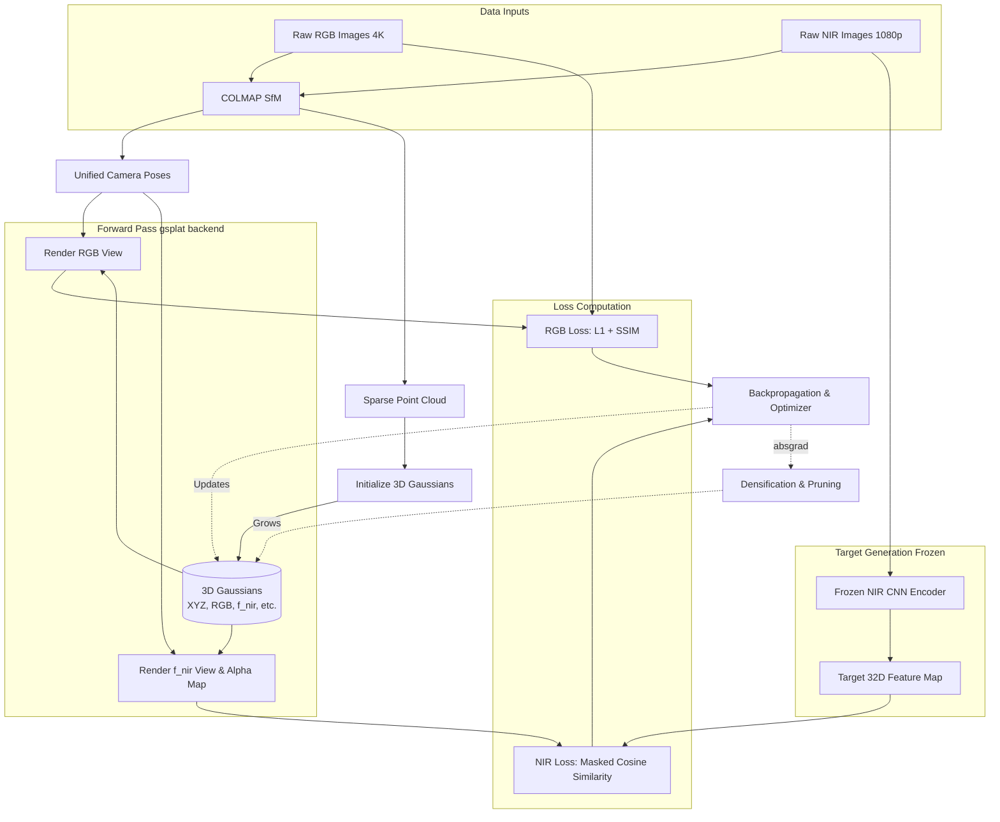

# Multimodal 3DGS Pipeline Overview

This document outlines the complete data flow and architectural pipeline for the Multimodal (RGB + NIR) 3D Gaussian Splatting project. You can use this to explain exactly where the data comes from, how it is processed, and where it goes.

## High-Level Data Flow Architecture

The following diagram illustrates the complete forward and backward pass of the modified 3DGS pipeline.

---

## Step-by-Step Pipeline Explanation

### 1. Data Ingestion & Preprocessing
*   **Inputs:** Raw RGB images and raw NIR images.
*   **Processing:** Both sets of images are fed into COLMAP (Structure-from-Motion) simultaneously.
*   **Outputs:** COLMAP estimates the 3D position and orientation of every camera (Camera Poses) and generates an initial low-density map of the scene (Sparse Point Cloud).

### 2. Gaussian Initialization
*   **Action:** The Sparse Point Cloud from COLMAP is used to spawn the initial set of 3D Gaussians.
*   **Our Modification:** Standard Gaussians only hold Position, Rotation, Scale, Opacity, and RGB color. We expanded the data structure so that every Gaussian now also holds a **32-dimensional `f_nir` feature vector**.

### 3. The Training Loop (Forward Pass)
During training, the system randomly picks a camera pose (either RGB or NIR).
*   **If it picks an RGB camera:** The `gsplat` rendering engine splats the 3D Gaussians onto a 2D canvas, outputting a Rendered RGB Image.
*   **If it picks an NIR camera:** The `gsplat` engine splats the 3D Gaussians, but instead of colors, it blends their 32D `f_nir` vectors, outputting a **Rendered 32D Feature Map**. It also outputs an `alpha_map` (which tracks where the solid objects are vs. empty space).

### 4. Target Generation (The Ground Truth)
*   If the system picked an NIR camera, we need to know what the Gaussians *should* have rendered.
*   We take the actual, real-world Raw NIR Image for that camera pose and pass it through our **Frozen CNN Encoder**. 
*   **Output:** The CNN outputs a highly structured **Target 32D Feature Map**.

### 5. Loss Computation (Scoring the Model)
*   **RGB Loss:** We compare the Rendered RGB against the Raw RGB using standard $L_1$ and SSIM math.
*   **NIR Loss:** We compare the Rendered 32D Map against the Target 32D Map using **Cosine Similarity**. We explicitly multiply this score by the `alpha_map`. 
    *   *Why?* So the model only gets penalized for getting the solid geometry wrong, preventing it from trying to learn NIR features for the empty sky.

### 6. Backward Pass & Densification
*   **Backpropagation:** The computed loss tells the optimizer how to adjust the XYZ, RGB, and `f_nir` values of every Gaussian to make them better for the next loop.
*   **Densification:** We extract the `.absgrad` (absolute gradient) from the `gsplat` backend. This tells the system where the image is blurry. The system then clones or splits Gaussians in those blurry areas to add more detail to the scene.
